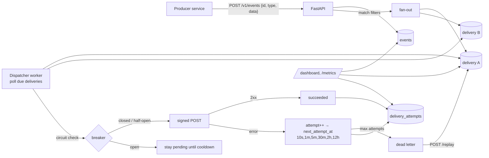

<!-- topics: fastapi,python,webhooks,reliability,retry,circuit-breaker,hmac,event-driven,sqlalchemy -->
# webhook-relay

A reliable webhook delivery service: publish an event once, and it is fanned out to every subscribed endpoint with HMAC signatures, exponential backoff, per-endpoint circuit breakers, dead-letter handling and one-click replay.

[](https://github.com/AkibUllah/webhook-relay/actions/workflows/ci.yml)


## Why this exists

Every payment and e-commerce platform I have worked on had to tell other systems that something happened: a bKash payment was captured, an order shipped, a KYC applicant was approved. The first version is always a `requests.post` in the request handler, and it breaks the first time the receiver is down for a deploy. Then retries get bolted on, then someone asks "did merchant X receive event Y, and can we send it again?", and nobody can answer. This service is that answer extracted into one place: durable deliveries with an attempt history, a retry schedule that backs off sensibly, a breaker that stops hammering a dead endpoint, and a dashboard that shows what is stuck.

## Features

- Endpoint registry: URL, signing secret (generated if omitted, shown once), description, event-type filters (`payment.*`, `order.paid`, `*`), active flag, secret rotation
- `POST /v1/events` fans out to every active endpoint whose filters match; client-supplied event ids are idempotent (re-publishing is a 200 no-op)
- Delivery worker with the schedule 10s → 1m → 5m → 30m → 2h → 12h (configurable), ±jitter, configurable max attempts, dead-letter after exhaustion
- `X-Relay-Signature: t=<ts>,v1=<hmac-sha256>` on every request plus event/delivery/attempt headers; a `verify_signature` helper for receivers
- Per-endpoint circuit breaker: opens after N consecutive failures, blocks sends for a cooldown, half-open probe, auto-close on success, manual reset endpoint; `410 Gone` deactivates the endpoint
- At-least-once semantics with full attempt history (status code, response excerpt, error, latency) and replay of any delivery, including succeeded ones
- Worker runs inside the API process (asyncio task) or as a separate process via `python -m webhook_relay.worker`, with graceful shutdown
- Dead-letter list, delivery filtering by status/endpoint/event, `X-Total-Count` pagination headers
- `/health`, `/metrics` (JSON counters: deliveries by status, success rate, open circuits, worker stats) and a server-rendered `/dashboard`
- Admin API key, structured error envelope, SQLite for dev/tests and PostgreSQL via docker compose

## Architecture



Design notes:

- **Deliveries are rows, not tasks.** A delivery is created in the same transaction as the event, so a crash after `201 Created` cannot lose a notification. The worker simply queries `status='pending' AND next_attempt_at <= now`.
- **Time is injected.** The dispatcher takes a `clock`; tests advance it to walk through the whole retry schedule and the circuit cooldown without sleeping.
- **The breaker is per endpoint and pure.** `core.circuit.Circuit` is an immutable value object; the dispatcher reads it from the endpoint row, applies success/failure, writes it back. Blocked deliveries stay pending with `next_attempt_at` pushed to the cooldown boundary so the loop does not spin.
- **Signatures cover the timestamp.** The signed string is `"<t>.<body>"`, and receivers check `t` against a tolerance window, so a captured request cannot be replayed later.
- **Replay keeps history.** Replaying resets the attempt counter but keeps every previous attempt row and increments `replay_count`, so an audit trail survives operator action.

## Tech Stack

| Layer | Choice |
| --- | --- |
| API | FastAPI, Pydantic v2, Jinja2 dashboard |
| Persistence | SQLAlchemy 2.0; SQLite (dev/tests), PostgreSQL 16 (compose, psycopg 3) |
| Worker | asyncio loop + httpx.AsyncClient with injectable transport |
| Config | pydantic-settings / `.env` |
| Tooling | pytest + pytest-asyncio, ruff, Makefile, GitHub Actions (3.10/3.11 + docker build) |

## Quick Start

### Docker Compose (API + dedicated worker + PostgreSQL)

```bash
git clone https://github.com/AkibUllah/webhook-relay.git && cd webhook-relay
cp .env.example .env
docker compose up --build -d
curl -s localhost:8000/health
open http://localhost:8000/dashboard
```

### Local (SQLite, worker inside the API)

```bash
make install
make dev                       # http://127.0.0.1:8000, docs at /docs
```

Register an endpoint, publish an event, watch it deliver:

```bash
export KEY=change-me   # API_KEY from .env (leave API_KEY empty to disable auth locally)

curl -s -X POST localhost:8000/v1/endpoints -H "X-API-Key: $KEY" -H "Content-Type: application/json" \
  -d '{"url":"https://webhook.site/your-id","event_types":["payment.*"],"description":"Shop backend"}'

curl -s -X POST localhost:8000/v1/events -H "X-API-Key: $KEY" -H "Content-Type: application/json" \
  -d '{"id":"evt-order-4521","type":"payment.captured","data":{"payment_id":"pay_1","amount_minor":150000,"currency":"BDT"}}'

curl -s "localhost:8000/v1/deliveries?status=dead" -H "X-API-Key: $KEY"
```

Verify a delivery on the receiving side:

```python
from webhook_relay.core.signing import verify_signature, SignatureError

try:
    verify_signature(
        secret, request.body, request.headers["X-Relay-Signature"], tolerance_seconds=300
    )
except SignatureError:
    return 400
```

## API

All `/v1` routes require `X-API-Key` when `API_KEY` is set. Errors are `{"error": {"code", "message"}}`.

| Method | Path | Purpose |
| --- | --- | --- |
| `POST` | `/v1/endpoints` | Register an endpoint (`url`, optional `secret`, `event_types`, `description`); returns the secret once |
| `GET` | `/v1/endpoints` · `/v1/endpoints/{id}` | List / fetch (secret never returned) |
| `PATCH` | `/v1/endpoints/{id}` | Update URL, filters, description, `is_active`; `rotate_secret: true` returns a new secret |
| `DELETE` | `/v1/endpoints/{id}` | Deactivate (delivery history kept) |
| `POST` | `/v1/endpoints/{id}/reset-circuit` | Close an open breaker manually |
| `POST` | `/v1/events` | Publish; `201` with deliveries, or `200` + `duplicate: true` for a known `id` |
| `GET` | `/v1/events` · `/v1/events/{id}` | List (filter `type`) / fetch with deliveries |
| `GET` | `/v1/deliveries` | Filter by `status`, `endpoint_id`, `event_id`; includes attempts |
| `GET` | `/v1/deliveries/{id}` | One delivery with full attempt history |
| `POST` | `/v1/deliveries/{id}/replay` | Re-queue for immediate send (`202`) |
| `GET` | `/v1/dead-letters` | Deliveries that exhausted `MAX_ATTEMPTS` |
| `GET` | `/health` | DB check, worker state |
| `GET` | `/metrics` | JSON counters |
| `GET` | `/dashboard` | HTML status page (auto-refresh) |

Request headers sent to endpoints: `X-Relay-Signature`, `X-Relay-Event`, `X-Relay-Event-Id`, `X-Relay-Delivery-Id`, `X-Relay-Attempt`, `X-Relay-Timestamp`. Body:

```json
{"id":"evt-order-4521","type":"payment.captured","created_at":"2026-10-21T09:00:00+00:00",
 "delivery_id":"dlv_…","attempt":1,"data":{"payment_id":"pay_1","amount_minor":150000,"currency":"BDT"}}
```

## Project Structure

```
webhook_relay/
├── main.py               # app factory, lifespan starts the worker task
├── worker.py             # python -m webhook_relay.worker
├── config.py · database.py · models.py · schemas.py
├── core/
│   ├── backoff.py        # schedule, jitter, next_attempt_at
│   ├── signing.py        # X-Relay-Signature build/verify
│   ├── circuit.py        # Circuit value object (closed/open/half_open)
│   └── matching.py       # event-type filters
├── services/
│   ├── events.py         # publish + fan-out, idempotent ids
│   ├── endpoints.py · deliveries.py (replay, dead letters)
│   ├── dispatcher.py     # the worker: claim, send, record, retry, breaker
│   └── metrics.py
├── api/                  # endpoints, events, deliveries, ops (+ dashboard)
└── templates/dashboard.html
tests/                    # 25 tests; MockTransport targets, injected clock
```

## Testing

```bash
make test
make lint
```

Covered: the retry schedule and jitter bounds; signature build/verify including tampering, stale timestamps and malformed headers; every circuit-breaker transition; filter matching and validation; endpoint CRUD with secret reveal/rotation; fan-out to matching active endpoints only; idempotent event ids; delivery listing/filters; the dispatcher end to end (signed request contents, success path, failure walk through 10s/1m/5m to dead letter, breaker opening and recovering after cooldown, half-open re-open and manual reset, independent fan-out outcomes, replay of dead and succeeded deliveries, `410` deactivation, batch size, inactive endpoints) and the in-process worker lifecycle.

Tests use an in-memory SQLite engine, an `httpx.MockTransport` as the receiving side and an injected clock, so they run in a couple of seconds with no network.

## Roadmap

- `SELECT … FOR UPDATE SKIP LOCKED` claiming so several worker replicas can share one PostgreSQL queue
- Per-endpoint rate limiting and concurrency caps
- Retention job that archives succeeded deliveries and attempts after N days
- Alembic migrations (schema is created with `create_all` today)
- Optional OpenTelemetry spans around each attempt

## License

MIT — see [LICENSE](LICENSE).
